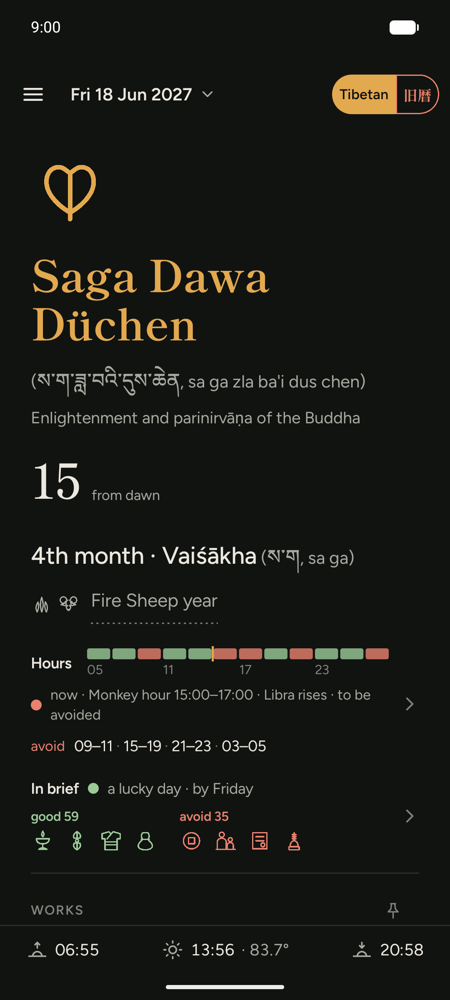
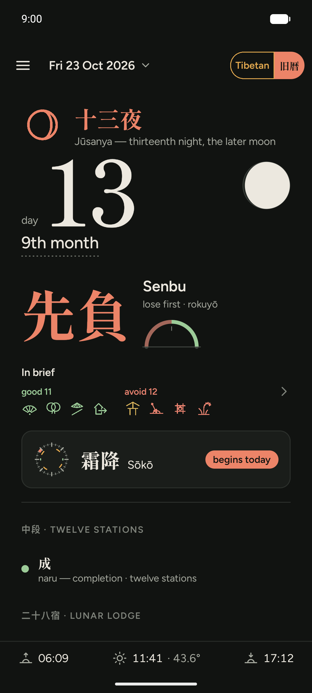
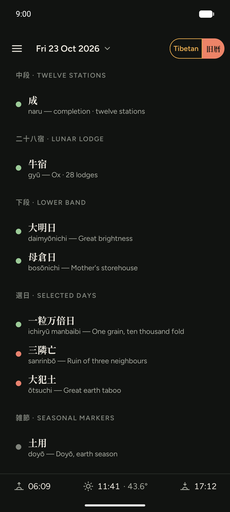
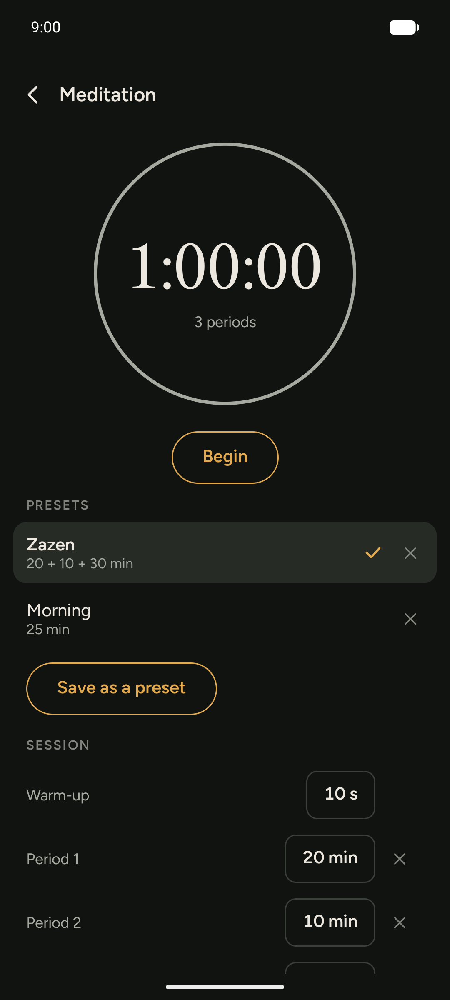

# Zanshin Calendar

An offline Android app that shows one day at a time in the Tibetan calendar
(Phugpa) or the old Japanese calendar (旧暦, Tenpō rules), with the almanac
readings of that day and sunrise, solar noon and sunset for your place.






- **Tibetan:** lunar day, month and year with skipped and doubled days and
  leap months; festivals and monthly observances; lunar mansion, yoga,
  karaṇa, element pair, lunar-day animal, trigram and number, each with its
  reading from the White Beryl and the *kun phan me long*; what changes
  within the day as the White Beryl's almanac writes it: a second mansion,
  a skipped yoga and Viṣṭi's span, with their times; what
  its month heading writes: long or short, the planet that rises, the
  black months, the sage's and the pig's seven days and the comet; the
  lunar and solar eclipses as its reckoning finds them, on their day, with
  the merit they multiply; the date's mewa, with what the activity lists
  name it for, and the twelve links counted from the month's middle term,
  each day's link with its works, directions and remedy; the fangs of the hundred feet on the birth mansion, and the spear
  and great spear on the moon's mansion; the
  bride's going for a person and their spouse, its seventeen checks on a
  day and on the election for a wedding; the
  earth lords of the year and the month on a compass, each with the works
  it bars in its place and its remedy, not weighed; the
  hours with the combination period, the earth lords of the hour, the
  black hours, what each hour is good for, the four rough times at
  sunrise, noon, sunset and midnight, and the works an hour turns
  against the day's animal sign; the page in those texts' order of strength: the hours
  above the day, the day in brief with the works it allows and forbids
  and the one factor that decides, on today's page as they stand in the
  hour now, then the readings; the works one pins, each as the brief
  weighs it, and the haircut as it stands in the hour now, and personal
  days and mansions for a birth year.
- **Reckonings:** the White Beryl's element reckoning for each person,
  its pebbles counted, not cast: the year of age, year by year, with its
  mewa, trigram and progressed sign, the aspect that matters most for the
  person, the pebbles with their predictions, the stage of each aspect's
  energy, and the year's obstacles, each with the remedies the White
  Beryl gives for it, and the year read together, its obstacles graded
  against the four aspects and its remedies gathered; with the relatives
  entered for a person, the natal trigram and the obstacles a spouse, a
  parent or a son brings; and the birth: what the natal trigram makes of each
  aspect, glory and misfortune against the parents, the
  line of births from the father and grandfather, the nature of the birth year, by its
  animal and among the sixty years, its body and its mewa, its aspects' rise and decline and the precious pebbles at the birth, the hundred pebbles on their board with the twenty deciding ones, the birth read together with its sets and its remedies gathered, whether the child is hard to raise, the natal trigram, the child of
  the gods, glory, life, spirits or demons it makes one, the birth
  year's destiny against its life force, its place, its luck triad and
  the cutting among its aspects, the year against one's clan, and the readings of the parents' trigrams at the
  birth; and the marriage match with a spouse: the bad years, the four aspects met one
  by one, the two destinies together, a shared year animal or element, the pairs of year animals, the birth mewas, the natal trigrams (with both mothers entered), each life force on the other's year, the stages counted from the parents' years, the same planet of birth, whether the match is reversed, the hidden and the deeper hidden of the four aspects' mewas, the siblings' number, the kind of wife each aspect makes and one pebble for the couple's bad years, and the match read together with its remedies gathered; and for a relative who has died, whether the time of death had come, by the four aspects' deciding pebbles, the reason the death met, which spirit carried the dead off, where it is reborn and the help by virtue for it; the thirty starting points and the thirteen circles of one's year; and the present moment: its trigram and mewa with their readings, the mewa as a place and in the kin's places, one's house, field and grave against the moment's sign, kin and enemy at one's own place, wealth, beer, the neighbouring houses, the sick, food, trade and disputes, the three mewa joined over the nine squares, and the thirteen gates with the counts after them.
- **Health:** what falling ill today means by the date, the weekday,
  the link and the goddess of the day, the four perilous days; where the
  la sits by the date and moves through the day; the day's mansion as a
  quarter of your element, the la's element, the vitality and body of
  the date and the year of age on the seven-red; the medical works as
  the day is weighed; the Four Tantras' humours and seasons; and each
  element's illness, where it lies, its door and its signs; and the
  illness reckoning for an illness that came on at a given time: the
  trigram, day animal, mewa and planet of that moment with their
  spirits, ransoms and rites, the illness named by five pebbles, the
  kind of harmful spirit, the progressed sign and the sky year, the
  nineteen pebbles, the people the sick need, and the board of the
  fifteen starting points with its four plank-trees, also among the
  Reckonings. The tradition's readings, not medical advice.
- **旧暦:** month and day with the moon's age, 六曜, the current solar term
  with its reading and the whole ring of the 24, moon phase, 十二直, 二十八宿,
  九星 of the day, month and year, 選日 and 暦注下段 (with the lower band's
  own rules), 雑節, 干支 and 恵方; every row opens its reading or its facts.
- **Choose a day:** the best days for a work over one to twelve months,
  ranked as the texts weigh them, each month a grid of its lunar dates
  with their civil days and its good hours; on the 旧暦 page the days the
  annotations name good, in date order.
- **Meditation:** a timer of a warm-up and periods of any length, a wood
  block between periods (as a zazen of 20, 10 and 30 minutes), saved as
  presets, ringing with the screen off or, if you choose, keeping it on
  until you leave the timer; and a mindfulness bell through the
  day, at fixed or random times within set hours, showing a message of
  your own while it rings. The bells are
  synthesised on the phone, so no sound file is bundled.
- Every Tibetan term and kanji shows its English on tap; every reading comes
  from a published source, listed in About & sources.
- Six themes: Ink (dark, the default), Paper (light), Night (black, for
  OLED screens), Maroon (the robe's maroon with saffron), Sepia (a
  parchment page for the evening) and the phone's own dark or light
  setting.
- Large fonts and wide screens: the pages follow the phone's font size up
  to twice the default without clipping, and in landscape or on a tablet
  stand in two columns, the day at a glance beside its sections.
- A morning notice, if you switch it on: once a day at the time you set,
  silently, the day in brief of the calendar last read, the Tibetan
  day's tone and the factor that decides it, the works good and to
  avoid and the hours against the tone, or the 旧暦's 六曜 and day mark;
  a tap opens the day.
- Two home-screen widgets for the calendar last read, in the app's theme
  and language: Day, the date, the day and its tone with the factor that
  decides it (on the 旧暦, the works good and to avoid); Day and hours,
  with the twelve hours of the Tibetan day in their verdict's colours,
  the present one marked and the hours against the tone (and, where the
  cell is tall enough, the sun's times and your own day), or the 旧暦's
  六曜 and day mark. A tap opens the day.
- Dates from 1900 to 2100, any month three taps away in the date picker's
  years and months. No internet permission: everything is computed on
  the phone.

## Install

[](https://f-droid.org/packages/io.github.iverlein.zanshin/)

Website: [zanshin.fyi](https://zanshin.fyi/)

## Build

JDK 21 and the Android SDK (platform 37) are needed.

```bash
./gradlew :core:test          # calendar engines
./gradlew :app:assembleDebug  # app/build/outputs/apk/debug/app-debug.apk
./gradlew :cli:run --args="2026-10-23"   # one day as text, on the desktop
```

The test vectors (published tables from Janson, Henning, NAOJ and
こよみのページ) are not in this repository; tests that need them are skipped.

The design, the formulas and their sources are in [docs/SPEC.md](docs/SPEC.md).

## Support

[Give me a tip](https://zanshin.fyi/donate/)

## Licence

Zanshin Calendar is free software under the [Mozilla Public License 2.0](LICENSE).

- Fonts: Figtree and Shippori Mincho, SIL Open Font License 1.1
  ([app/src/main/assets/licenses/](app/src/main/assets/licenses/)).
- City list: [GeoNames](https://www.geonames.org/), CC BY 4.0.
- Readings adapted from Japanese Wikipedia: CC BY-SA 4.0, credited in About &
  sources.
  All other readings are the project's own summaries of the cited sources.
